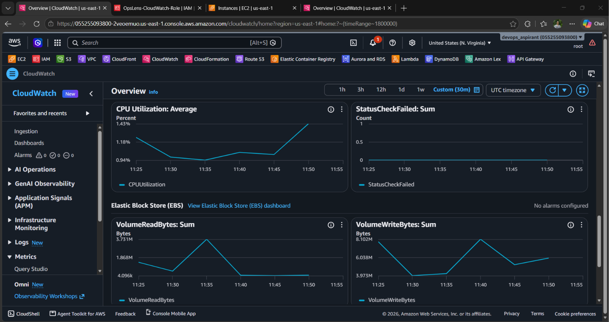
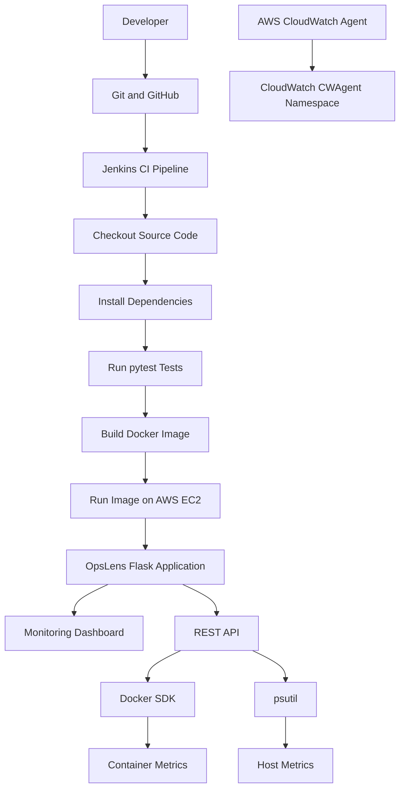

# OpsLens — Container Observability Platform

**A lightweight container monitoring platform built with Python, Flask, Docker, Jenkins, and AWS.**

OpsLens provides a web dashboard and REST API for monitoring Docker container health, CPU usage, memory usage, runtime status, and host-level metrics. This project demonstrates practical Cloud and DevOps skills, including Linux administration, containerization, automated testing, CI pipelines, and AWS monitoring.

---

## 📑 Table of Contents

- [Project Overview](#-project-overview)
- [Features](#-features)
- [Screenshots](#-screenshots)
- [Project Architecture](#-project-architecture)
- [Technologies Used](#-technologies-used)
- [Project Structure](#-project-structure)
- [Installation and Setup](#-installation-and-setup)
- [API Endpoints](#-api-endpoints)
- [Testing](#-testing)
- [Jenkins CI Pipeline](#-jenkins-ci-pipeline)
- [AWS CloudWatch Monitoring](#-aws-cloudwatch-monitoring)
- [Security Considerations](#-security-considerations)
- [Future Scope and Improvements](#-future-scope-and-improvements)
- [Learning Outcomes](#-learning-outcomes)
- [Author](#-author)

---

## 🎯 Project Overview

OpsLens is a container observability project deployed on an AWS EC2 instance running Amazon Linux 2023.

The application uses Flask to provide a monitoring dashboard and REST API. Docker SDK and psutil are used to collect container and host resource information.

A Jenkins pipeline automates source-code checkout, dependency installation, automated testing, and Docker image building. AWS CloudWatch Agent is configured to collect host metrics.

The goal is to demonstrate how container monitoring, automated testing, continuous integration, and cloud infrastructure work together in a practical DevOps environment.

## ✨ Features

- 📊 Web-based container monitoring dashboard
- 🐳 Docker container status and identification
- 💻 Container CPU and memory usage metrics
- 🖥️ Host CPU and memory monitoring
- ⏱️ Container uptime information
- 🔌 REST API for retrieving monitoring data
- ☁️ AWS EC2 hosting on Amazon Linux 2023
- 📈 AWS CloudWatch Agent metrics
- ⚙️ Jenkins CI pipeline
- 🧪 Automated testing using pytest
- 📦 Docker image building and container deployment

---

## 📸 Screenshots

### 1. OpsLens Monitoring Dashboard

Displays the container monitoring dashboard and available resource metrics.

<p align="center">
  
</p>

### 2. Metrics API Response

Shows the JSON response returned by the `/api/metrics` endpoint.

<p align="center">
  
</p>

### 3. Jenkins CI Pipeline

Shows the Jenkins pipeline and successful build results.

<p align="center">
  
</p>

### 4. AWS CloudWatch Metrics

Shows the configured CloudWatch Agent metrics collected from the EC2 environment.

<p align="center">
  
</p>

---

## 🏗️ Project Architecture



### Architecture Workflow

1. **Source control:** Source code is maintained in GitHub.
2. **Continuous integration:** Jenkins checks out the repository.
3. **Dependency installation:** Jenkins creates a Python virtual environment and installs the required packages.
4. **Automated testing:** pytest executes the project's automated tests.
5. **Docker image build:** Jenkins builds a versioned Docker image after successful tests.
6. **Application runtime:** The OpsLens container runs on AWS EC2.
7. **Metrics collection:** Docker SDK and psutil collect configured container and host metrics.
8. **Cloud monitoring:** AWS CloudWatch Agent publishes configured host metrics to CloudWatch.

**Current status:** The Jenkins CI pipeline has successfully passed three tests and built the Docker image. The Jenkins-built image has also been run on EC2, and the metrics API has been verified. Automatic deployment after every successful build is a future improvement.

---

## 🛠️ Technologies Used

| Technology | Purpose |
|---|---|
| Python | Application logic and monitoring |
| Flask | Web application and REST API |
| Docker | Containerization and image building |
| Docker SDK for Python | Docker container monitoring |
| psutil | Host resource monitoring |
| AWS EC2 | Cloud hosting |
| Amazon Linux 2023 | Linux operating environment |
| AWS CloudWatch Agent | Host metrics collection |
| Jenkins | CI pipeline automation |
| Git and GitHub | Version control and source hosting |
| pytest | Automated testing |

---

## 📂 Project Structure

```text
OpsLens/
├── .github/
│   └── workflows/
│       └── tests.yml
├── app/
│   ├── __init__.py
│   ├── monitor.py
│   └── routes.py
├── docs/
│   ├── CloudWatch-metrics.png
│   ├── Jenkins pipeline.png
│   ├── Metrics API response.png
│   └── OpsLens dashboard.png
├── static/
│   └── style.css
├── templates/
│   └── index.html
├── tests/
│   └── test_monitor.py
├── .dockerignore
├── .gitignore
├── Dockerfile
├── Jenkinsfile
├── README.md
├── app.py
├── docker-compose.yml
└── requirements.txt
```

---

## ⚙️ Installation and Setup

### Prerequisites

- Git
- Docker Engine
- Python 3.12 or a compatible version supported by the project
- An AWS EC2 instance or another Linux environment
- Docker access for container monitoring

### 1. Clone the Repository

```bash
git clone https://github.com/Tanujashinde2798/OpsLens.git
cd OpsLens
```

### 2. Build the Docker Image

```bash
docker build -t opslens:v1 .
```

### 3. Run the Container

The following command follows the current EC2 deployment pattern, binding port 5000 to localhost and mounting the Docker socket for container monitoring.

```bash
docker run -d \
  --name opslens \
  -p 127.0.0.1:5000:5000 \
  -v /var/run/docker.sock:/var/run/docker.sock \
  --restart unless-stopped \
  opslens:v1
```

### 4. Verify the Container

```bash
docker ps
docker logs --tail 30 opslens
```

### 5. Open the Dashboard

On the same machine, open:

```text
http://127.0.0.1:5000
```

For an EC2 deployment, use an SSH tunnel from your local computer to access the dashboard without exposing port 5000 publicly.

### 6. Verify the Metrics API

```bash
curl http://127.0.0.1:5000/api/metrics
```

The endpoint should return JSON containing the available container and host metrics.

### 7. Stop the Container

Only when you want to stop and remove the application container:

```bash
docker stop opslens
docker rm opslens
```

---

## 🔌 API Endpoints

| Endpoint | HTTP Method | Description |
|---|---|---|
| `/` | GET | Displays the OpsLens dashboard |
| `/api/metrics` | GET | Returns container and host monitoring metrics |
| `/api/logs` | GET | Returns the application's configured log information |

### Example: Metrics API

Request:

```bash
curl http://127.0.0.1:5000/api/metrics
```

Illustrative response:

```json
{
  "containers": [
    {
      "id": "094d544254d7",
      "name": "opslens",
      "status": "running",
      "cpu_percent": 0.01,
      "memory_percent": 1.5
    }
  ],
  "host_cpu_percent": 0.0,
  "host_memory_percent": 49.0,
  "timestamp": "2026-10-20 11:27:34 UTC",
  "uptime_seconds": 14
}
```

The values above are an example from a previous test. Actual values depend on the running environment and may change over time.

---

## 🧪 Testing

OpsLens uses pytest to validate application behavior.

### Install Dependencies

```bash
python3 -m venv .venv
source .venv/bin/activate
pip install -r requirements.txt
pip install pytest
```

### Run Tests

```bash
python -m pytest -v
```

### Verified Test Results

The successful Jenkins build completed these tests:

- `test_dashboard_returns_success`
- `test_metrics_endpoint_returns_expected_data`
- `test_logs_endpoint_returns_empty_errors`

**Result: 3 tests passed.**

---

## 🔄 Jenkins CI Pipeline

The Jenkins pipeline automates the following stages:

| Stage | Description |
|---|---|
| Checkout | Retrieves source code from GitHub |
| Install Dependencies | Creates a virtual environment and installs packages |
| Run Tests | Executes pytest |
| Build Docker Image | Builds the OpsLens Docker image |

The verified Jenkins build created the following image:

```text
opslens:jenkins-6
```

This image was subsequently run on EC2, and the metrics API was verified.

**Note:** The current Jenkins pipeline builds the image but does not automatically deploy every new build. Automated continuous deployment is planned as a future enhancement.

---

## ☁️ AWS CloudWatch Monitoring

The EC2 environment uses the AWS CloudWatch Agent to publish configured host metrics to the `CWAgent` namespace.

The monitoring setup includes:

- CloudWatch Agent installation and configuration
- An EC2 IAM role with the required permissions
- Host metric collection
- CloudWatch metric verification

The metrics collected depend on the CloudWatch Agent configuration.

---

## 🔐 Security Considerations

- **Docker socket:** Access to `/var/run/docker.sock` can provide extensive control over the host. Restrict access carefully.
- **Network access:** Avoid exposing the dashboard publicly without authentication and appropriate network controls.
- **AWS credentials:** Never commit AWS credentials, PEM private keys, access tokens, or secrets to GitHub.
- **IAM:** Use least-privilege permissions for AWS resources.
- **Production readiness:** Consider HTTPS, authentication, and a production WSGI server before production use.

---

## 🚀 Future Scope and Improvements

The following are planned improvements, not features currently claimed as implemented.

- **Continuous deployment:** Automatically deploy a new Docker image after a successful Jenkins build.
- **Production server:** Replace Flask's development server with Gunicorn.
- **Monitoring alerts:** Configure CloudWatch alarms for high CPU, memory, and important container events.
- **Historical metrics:** Store resource metrics and visualize usage trends over time.
- **Enhanced dashboard:** Add charts, filters, and detailed container views.
- **Security enhancements:** Add authentication and improve Docker socket isolation.
- **Image vulnerability scanning:** Scan Docker images as part of the CI pipeline.
- **Health checks and rollback:** Improve deployment reliability with health checks and rollback procedures.
- **Infrastructure automation:** Explore Infrastructure as Code as a future learning goal.

---

## 📚 Learning Outcomes

This project provided hands-on practice with:

- Linux administration on AWS EC2
- Docker image building and container management
- Python and Flask application development
- REST API testing
- Jenkins CI pipeline configuration
- Automated testing using pytest
- Git and GitHub workflows
- AWS CloudWatch Agent and host metrics
- Cloud deployment troubleshooting
